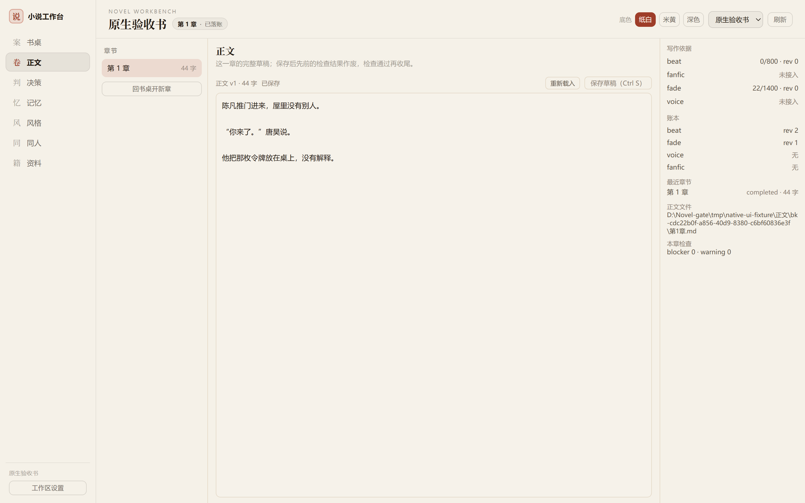

# 小说工作台 · dsh-novel-kit

**长篇写作，有据可续。** <sub>Long-form writing with continuity.</sub>

> 面向长篇连载与同人作者的写作工作台。它把章节计划、作者拍板、正文草稿、章节记忆、文风档案和原著依据放进同一流程：开章前整理可用资料，写后检查禁忌、称呼与已登记引文，再把正文和账本变更写入可恢复事务。模型可以提交候选，是否采纳、何时生效由作者决定。

`0.5.2` · MIT · 需要 Node ≥ 20 的 DeepSeek Harness · [更新日志](CHANGELOG.md)


## 它好在哪

- **打开就知道该写什么**：书桌只给一个主行动——「下一笔」，其余信息在侧栏，不拿十张卡片淹没你。
- **改稿不用满篇找**：禁忌词、与原著雷同、称呼不符这类问题，点「定位」直接选中那一句；不能定位的（比如文风区间）就老实写「全文级」。
- **世界观不会被模型偷偷改**：它能提候选，但候选只进队列；你不点接受、不点应用，正文就拿不到它。
- **换书不担心丢稿**：有未保存正文时切作品，它会拦住你问「保存 / 丢弃 / 取消」，而不是清空。
- **平时不打扰**：总开关默认关。不写小说的时候，它一个工具都不塞进你的会话。
- **暗色亮色都好看**：暖纸底、三级墨色、朱砂强调，全部由宿主主题色派生；深夜写和白天写同一套界面。

## 三分钟上手

安装后在会话里：

```text
/novel master on      # 打开总开关（默认关）
/novel on             # 只对本会话开放
```

打开「小说工作台」→ **书桌** → 没有作品就新建 → 去 **正文** 写第一章 → `Ctrl S` 保存。

想让它贴近你喜欢的那本书：**风格** 页导入一本小说；想写同人：**同人** 页导入原著，逐条审阅候选并应用。

## 每章怎么推进

```text
novel_plan              # 登记本章意图与待拍板提案
novel_chapter_start     # 装配依据，建立会话
novel_chapter_write     # 保存正文草稿
novel_chapter_finish    # 检查 → 提交正文与账本变更
novel_chapter_resume    # 恢复未完成会话
```

开章时工作台按预算装配四段可用依据（`beat` 800 字 / 原著 800 字 / 记忆 1400 字 / 文风 600 字），并记下每段的来源修订号。收尾时先检查：**禁忌、称呼、与已登记原文引文的重复、疑似错字提示、文风指标**——禁忌命中会阻止提交，其余提示按类型处理。

中断也没关系：事务没提交完时，`resume` 能看到进度；会话里没拿到回执时，`finish` 会按事务回执补齐会话，不会重复落账。

## 七页工作台

| 页 | 你在这里做什么 |
|---|---|
| **书桌** | 查看本章下一步、可用依据、待处理事项和最近章节 |
| **正文** | 编辑并保存草稿；查看本章检查，可定位的问题直接跳到正文 |
| **决策** | 处理待拍板提案，查看已拍板记录、未回收线索和全书拍板 |
| **记忆** | 检索章节记忆，查看人物与卡片详情；可钉住、遗忘或恢复卡片 |
| **风格** | 导入样本，查看句长、段长、对话比例和用词密度等统计及基础规则 |
| **同人** | 导入原著，查看人物与设定、原文引文和候选队列；接受的候选还要应用后才进入写作依据 |
| **资料** | 查看来源、本章依据预览、操作记录、诊断和工作区设置 |



## 检查结果能定位到哪里

不是所有提示都能跳到句子：

| 检查 | 能否定位 |
|---|---|
| 禁忌词命中 | 能，选中那一处 |
| 与已登记原文引文重复 | 能，选中重复段落（带换行的正文也能算准） |
| 称呼矩阵不符 | 能，定位到出现该称呼的地方 |
| 疑似写错的名字 | 能，定位到那个词 |
| 文风区间偏离 | **不能**，属于整章统计指标，界面上标「全文级」 |

## 保存草稿与切换作品

- 切换作品时若草稿尚未保存，会先让你选择**保存、丢弃或取消**；
- 保存请求返回后会核对**当前书、章节和编辑序号**，避免旧响应覆盖新稿；
- 保存按钮与 `Ctrl S` 共用一个互斥口，不会并行写入；
- 载入响应也认归属，晚到的那份直接丢弃。

## 同人：候选先审，再应用

原著导入后，可以让模型读取章节并提交人物、称呼、事实、关系、规则或禁忌等候选。候选进入队列后由作者接受或拒绝；**接受不等于生效，只有应用后才进入写作依据**。队列保留审阅记录，已拒绝的候选不会进入上下文。


整份覆盖式的旧接口已经关掉——包括作者命令与模型工具。想改世界观，只有「提候选 → 审 → 用」这一条路。

## 文风工作室

导入 UTF-8 文本样本后，工作台统计句长、段长、对话比例及抽象词、解释词密度，并按统计结果生成区间和少量基础规则。收尾时会提示文风指标偏离；**只有带正文位置的问题才能定位到具体文字**。

新建档案的避免词与决策倾向默认为空，需要你在档案里补；它们不会从样本里凭空生成。

## 开关与安装

```text
/novel master on|off     # profile 级总开关，默认关，跨重启保留
/novel on|off            # 只影响本会话
/novel mode original|fanfic <书>
/novel status
```

安装：DSH → 设置 → 插件 → 搜索「小说工作台」→ 安装 → 重启 DSH → 打开工作台。

原创模式即使误绑同人项目也不会注入世界事实；同人模式缺原著或契约未应用时，开章会直接拒绝，不会无约束硬写。

## 数据与开发

项目设置、导入文本、风格档案、原著设定、章节会话和事务记录都保存在工作区文件中，可自行备份；卸载工作台不会删除这些数据。

```text
npm test                 # 单元/集成测试
npm run acceptance       # 行为验收
npm run acceptance:load  # 加载链验收（锁「重启后整包消失」）
npm run check            # 语法 + 构建产物一致性
npm run build:client     # 样式/契约/ui-kit 三个块内联进 client.js
npm run ui:snapshot      # 七个页面 × 暗亮 出图
```

源码结构：`lib/engine/`（章节、canon、上下文、检查）、`lib/host/`（工具、命令、remote、视图）、`client.js`（工作台 UI，由 `client-src/` 与本仓库源码构建内联）。边界见 [docs/LIMITS.md](docs/LIMITS.md)，界面规范见 [docs/UI-V2.md](docs/UI-V2.md)。

## 给老用户：从旧插件迁移

早期用户如果安装过 beat / fade / voice / fanfic / conductor，请先备份工作区，再安装工作台并执行 `/novel legacy` 登记已有项目。确认作品、章节和账本可正常读取后，再逐个停用旧插件，避免两套写入流程同时修改同一份数据。

旧文风库与旧同人项目仍可兼容读取；要建立工作台自己的文风档案，请重新导入并确认；要启用原著设定，则需提交候选、逐条审阅并应用。

## 共同作者

v0.5.2 共同作者：[MiyueWinter](https://github.com/MiyueWinter) —— 文案、测试、设计与开发。

## 喜欢它？

如果「拍板」帮你在 AI 写作中掌握了关键剧情的决定权，也让长篇的设定和前文有处可查，欢迎在 [GitHub](https://github.com/DrizzleGig/dsh-novel-kit) 点亮 ⭐，也欢迎 [Issue](https://github.com/DrizzleGig/dsh-novel-kit/issues) 或 [PR](https://github.com/DrizzleGig/dsh-novel-kit/pulls)。

## 许可证

MIT License，见 [LICENSE](LICENSE)。
