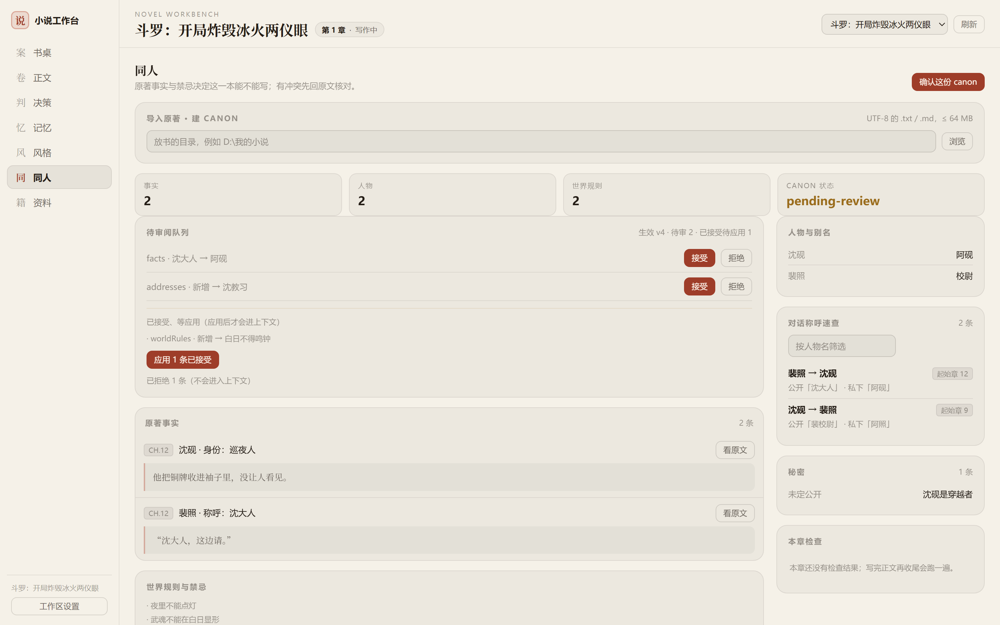

# 小说工作台 · dsh-novel-kit

**一章一条链，长篇不散架。** <sub>One workbench. One chain per chapter.</sub>

> 一个界面写完一部长篇：书桌、正文、决策、记忆、风格、同人、资料七页。
> 每章都有始有终——先装配依据，再写，写完接受检查，最后落进一个可恢复的事务。

`0.5.0` · MIT · 需要 Node ≥ 20 的 DeepSeek Harness · [更新日志](CHANGELOG.md)


## 三分钟上手

安装后在会话里：

```text
/novel master on      # 打开总开关（默认关）
/novel on             # 只对本会话开放
```

打开「小说工作台」→ **书桌** → 没有作品就新建 → 去 **正文** 写第一章 → `Ctrl S` 保存。

想让它写得像你喜欢的那本书：**风格** 页导入一本小说；想写同人：**同人** 页导入原著，逐条审阅世界契约。

## 它解决什么

AI 写长篇，卡人的不是「写不出来」，是这三件事：

- **会忘**：上一章的人、事、伏笔，写到第三十章只剩一个大概；
- **会飘**：设定、称呼、禁忌前后矛盾，越写越像另一本书；
- **会不像你**：句子、节奏、对话比例千篇一律，读起来像 AI 写的。

工作台把「剧情决策 / 世界契约 / 长篇记忆 / 文风」收成**四段写作依据**，每次动笔前按预算装配好送进上下文；收尾时把正文、剧情账、记忆卡放进**同一个可恢复事务**。

它不是「再装一个写作工具」，而是**一条链**：导入 → 计划 → 拍板 → 开章 → 写 → 检查 → 落账。

## 适合谁

- 写到二三十章开始「接不上」的连载作者；
- 需要人物称呼、设定、禁忌不前后矛盾的作者；
- 想让 AI 贴近自己写法、而不是通用 AI 腔的写手；
- 写同人，需要把原著事实钉死、还要逐条过目的作者。

**不适合**：想要「一句话生成整本书」的人——这里每一步都要你拍板。

## 七页工作台

| 页 | 你在这里做什么 |
|---|---|
| **书桌** | 看「下一笔」：唯一的主行动、四段依据状态、本章场景、待处理收件箱、最近章节 |
| **正文** | 写完整正文，Ctrl S 保存；右侧常驻四段依据与账本；下方是本章检查，「定位」直接选中要改的那一句 |
| **决策** | 待拍板提案、已拍板记录、未回收线索、章节历史。模型只能提议，拍板永远是你 |
| **记忆** | 事件卡、钉住的硬信息、正在淡出的旧事；可钉、可遗忘、可恢复 |
| **风格** | 导入你喜欢的小说，得到文风档案：句长/段长/对话比区间、要避免的词、收束倾向与文风适配判断 |
| **同人** | 导入原著，得到世界契约：人物、称呼矩阵、事实、关系、禁忌、秘密；逐条审阅后应用 |
| **资料** | 四段依据的版本对照、账本目录、工作区设置与总开关 |

主栏 + 右侧 300px 侧栏；窗口窄于 1080px 时自动收成单栏。


## 一条链：一章怎么走

```text
novel_plan              # 登记提案（模型只能 propose，拍板在你）
novel_chapter_start     # 装配四段依据，开会话
novel_chapter_write     # 保存完整草稿（版本 + 内容哈希）
novel_chapter_finish    # 检查 → 事务落账 → 回执
novel_chapter_resume    # 中断后接着来
```

`finish` 先跑确定性检查：**禁忌词、与原著连续相同、疑似写错的名字、称呼矩阵、文风区间**。blocker 不落账；通过后正文、剧情段落、记忆卡在同一个可恢复事务里提交，并返回回执。中断了，`resume` 能看到事务进度；会话里没拿到回执时，`finish` 会按事务回执补齐会话，不会重复落账。

## 四段依据，各有预算与版本

| 段 | 装什么 | 预算 |
|---|---|---|
| 剧情 | 本章已拍板决策、未回收线索、本书 canon | 800 字 |
| 世界 | 称呼矩阵、禁忌、事实、关系（同人） | 800 字 |
| 记忆 | 近章事件卡 + 长期线索，越旧越淡 | 1400 字 |
| 文风 | 句长/对话比区间、要避免的词、决策倾向 | 600 字 |

每段都记录来源修订号。**依据变了会明确告诉你**：改的是预算之外的内容也算——章节检查读的正是那些内容。

## 草稿是你的，不会丢

- 有未保存正文时切换作品，不会静默清空，而是先问你：**保存并切换 / 丢弃并切换 / 取消**；
- 保存按钮与 Ctrl S 共用一个互斥口，连点不会把版本号踩乱；
- 保存回包会校验「书 + 章节 + 编辑序号」，期间切走了就只提示，不往当前编辑器里写；
- 载入响应也认归属，晚到的那份会被丢弃，不会把 A 章的稿子写进 B 章。

## 同人：先审阅，再生效

原著导入后，模型可以提候选变更（人物、称呼、事实、规则、禁忌……），但**只能进待审阅队列**：



- 队列顶部一行说清三层状态：**生效版本 v4 · 待审 2 · 已接受待应用 1**；
- 逐条「接受 / 拒绝」，每次审阅都留痕，不会覆盖上一次的决定；
- 接受 ≠ 生效：**只有点了应用才进写作依据**；
- 生效内容与文件版本分开记账（`revision` / `contractRevision` / 内容指纹）：拒绝一条提案不会让上下文失效，接受但没应用的内容不会混进正文。

整份覆盖式的旧接口已经全部关掉——包括作者命令与模型工具。想改世界观，只有「提候选 → 审 → 用」这一条路。

## 文风：学的是写法，不是抄句子

导入一本你喜欢的小说，得到的是**可执行的档案**，不是形容词：

- 句长均值与波动、段长、对话占比、抽象词密度——都有区间；
- 要避免的词，以及从样本里提取的收束倾向；
- 规划时给文风简报，提案可以带「文风适配 + 理由」，写完后把越界的地方指到具体那句。

文风与世界观是**两个独立产物**：学文笔只影响怎么写，不往你的世界里塞事实；写同人只管世界约束，不改你的句子。

## 开关默认是关的

```text
/novel master on|off     # profile 级总开关，默认关，跨重启保留
/novel on|off            # 只影响本会话
/novel mode original|fanfic <书>
/novel status            # 看总开关 / 本会话 / 工具数
```

不写小说的时候，它**不会把任何工具塞进你的会话**。原创模式下即使误绑了同人项目，也不会注入世界事实；同人模式缺原著或契约未确认，开章直接拒绝，不会无约束硬写。

## 安装

1. DSH → 设置 → 插件 → 搜索「**小说工作台**」→ 安装；
2. 重启 DSH，会话里出现「小说工作台」入口；
3. `/novel master on` → `/novel on`；
4. 打开工作台开始写。

## 数据放在哪

全部是**工作区里的普通文件**，可以直接备份、用 git 管、手动看：

```text
<workspace>/.dsh-novel-kit/
  ├─ projects/<书>/settings.json        # 模式、文风与 canon 绑定
  ├─ sources/<sha256>/                  # 导入的原文（按内容去重，一份）
  ├─ styles/<profileId>.json            # 文风档案
  ├─ canon/<书>/<sourceId>/world.json   # 世界契约（含待审队列与审阅历史）
  ├─ sessions/  transactions/  operations/   # 会话、可恢复事务、作者操作日志
  └─ ...
```

剧情账与记忆账沿用 `.dsh-novel-beat/`、`.dsh-novel-fade/` 目录结构，**卸载插件不会删数据**。

## 给老用户：从旧插件过来

早期版本拆成五个独立插件（beat / fade / voice / fanfic / conductor）。工作台已经是独立包，**不再依赖任何一个**：

1. 先备份工作区里的 `.dsh-novel-*` 目录；
2. 装工作台 → `/novel master on` → `/novel on` → `/novel legacy`（把旧书登记成工作台项目，就地读写，不复制不改格式）；
3. 确认书、章节、拍板、记忆都在；
4. **再卸载**那五个插件——两套执行者同时写同一本账会重复登记或撞版本冲突。

旧文风库与旧同人项目是只读兼容；要用工作台自己的档案，用「学文笔」「写同人」重新导入并确认一次即可。

## 开发

```text
npm test                 # 单元/集成测试
npm run acceptance       # 19 项行为验收
npm run acceptance:load  # 8 项加载链验收（专门锁「重启后整包消失」）
npm run acceptance:real  # 用真实账本副本跑一章，不动原书
npm run check            # 语法 + 构建产物一致性
npm run build:client     # 样式/契约/ui-kit 三个块内联进 client.js
npm run ui:snapshot      # 七个页面 × 暗亮 出图
```

源码结构：`lib/engine/`（章节、canon、上下文、检查）、`lib/host/`（工具、命令、remote、视图）、`client.js`（工作台 UI，由 `client-src/` 与本仓库源码构建内联）。

边界与未完成项见 [docs/LIMITS.md](docs/LIMITS.md)，开发状态见 [docs/DEV-STATUS.md](docs/DEV-STATUS.md)，界面规范见 [docs/UI-V2.md](docs/UI-V2.md)。

## 许可

MIT · 作者 **DrizzleGig** · 协作者 **MiyueWinter**
