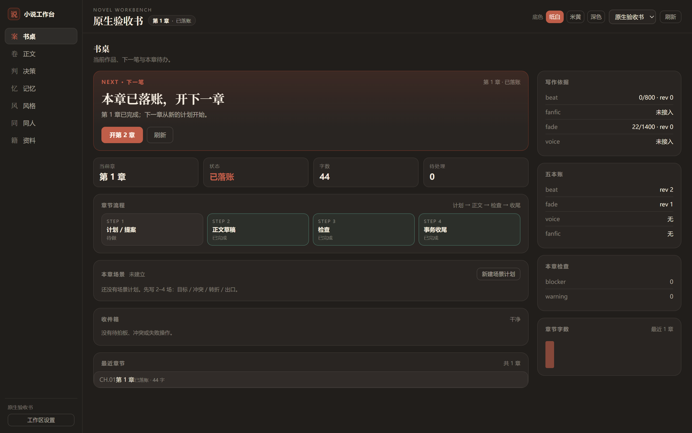
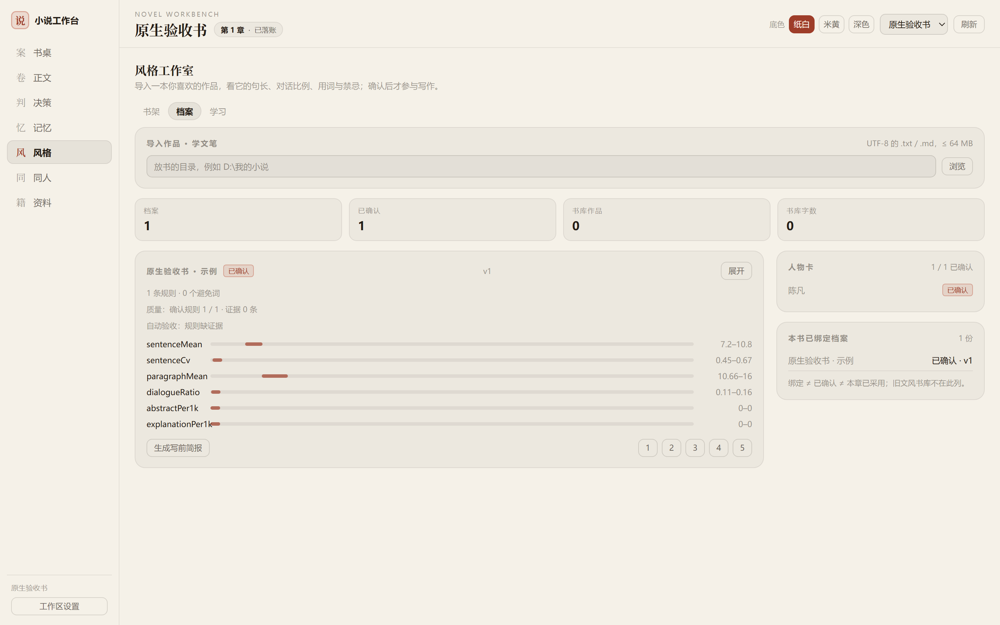

# dsh-novel-kit

把写小说需要的东西，放进一张自己的工作台。

dsh-novel-kit 是一款独立小说工作台。它把剧情决策、长篇记忆、创作风格、同人设定、资料管理和创作手册放在一起，让作者不用在多个工具之间来回切换，也能从构思、写作到回顾，始终掌握自己的作品。



## 版本口径

当前版本：`0.7.0`

0.7.0 是独立小说工作台的第一个正式版本。dsh-novel-kit 以独立工作台的形式原生实现各项创作能力，不依赖其他小说插件。

旧版 beat、fade、voice、fanfic、conductor 的数据可以通过一次性只读继承导入。导入仅用于接收已有资料，不会与原插件建立联系，也不会反向修改原插件的数据。

## 这一版能做什么

0.7 将小说创作中常用的能力整合进七个固定页面：

- **管理作品**：集中查看作品、章节和创作进度。
- **编辑正文**：在工作台中阅读和写作小说。
- **掌握剧情**：记录重要决定，查看不同选择及其影响。
- **延续记忆**：整理人物、事件、关系和世界变化，为后续写作提供参考。
- **形成风格**：整理喜欢的作品与自己的创作，建立可使用的风格档案。
- **创作同人**：导入原著、整理原著事实，并维护本作自己的设定。
- **管理资料**：保存创作手册、参考资料和写作过程中需要反复查阅的内容。

这些能力由工作台自身提供，不需要分别安装一组写作插件。

## 快速开始

安装后，在会话里：

```text
/novel master on      # 打开总开关（默认关）
/novel on             # 只对本会话开放
```

打开「小说工作台」→ **书桌** → 输入作品名点「新建作品」→ **正文** 开始写第一章。

不需要一次完成所有准备。可以先建立作品、开始写作，再逐步补充其他内容。

## 工作台各页

### 书桌

作品的总入口。集中查看正在创作的小说，了解作品概况和当前进度，从这里进入不同创作页面。

### 正文

小说的主要写作空间。围绕章节和正文开展创作，让作品本身始终处于工作台的中心。

### 决策

记录影响故事走向的重要选择。

当剧情面临不同发展方向时，可以整理候选分支、选择及其后续影响，让重要决定有迹可循，故事始终由作者掌握。

### 记忆

为长篇小说整理持续变化的信息。

将人物状态、关系、事件和重要事实沉淀为后续写作可以参考的记忆，减少写到后面忘记前文细节的情况。

### 风格

建立自己的创作风格档案。

整理喜欢的作品与个人创作，提炼叙述方式、表达习惯和写作手法，为后续创作提供风格参考。

### 同人

围绕原著与本作开展同人创作。

整理原著事实，维护本作设定，区分原著内容与作者有意作出的二创改变。尊重原著，也保留自由创作的空间。

### 资料

集中管理创作过程中需要使用的内容，包括创作手册（runbook）、参考资料和其他写作辅助材料，让重要信息方便查找和复用。



## 原则与边界

- **作者决定故事方向**：工作台提供整理、参考和辅助能力，不替作者决定剧情。
- **正文属于作者**：工具辅助创作，不以自动生成和修改正文代替作者的创作判断。
- **原创与同人都可以使用**：既支持从零开始创作，也支持围绕原著进行二次创作。
- **七页固定，各司其职**：决策、记忆、风格、同人和资料分别服务于不同创作需要。
- **独立运行**：不依赖、不交互、不写入 beat、fade、voice、fanfic、conductor。
- **旧资料只读继承**：五件旧工具的数据仅支持一次性只读导入，不建立自动同步或持续联动。

## 安装

需要 DeepSeek Harness。工作台可独立安装，其他小说插件均为可选。

```bash
dsh plugin --profile web add dsh-novel-kit@0.7.0
```

web 是示例 profile；桌面端按实际 profile 替换。安装后重启 Harness，打开「小说工作台」。

## 许可证

MIT License，见 [LICENSE](LICENSE)。第三方说明见 [THIRD_PARTY_NOTICES.md](THIRD_PARTY_NOTICES.md)。
